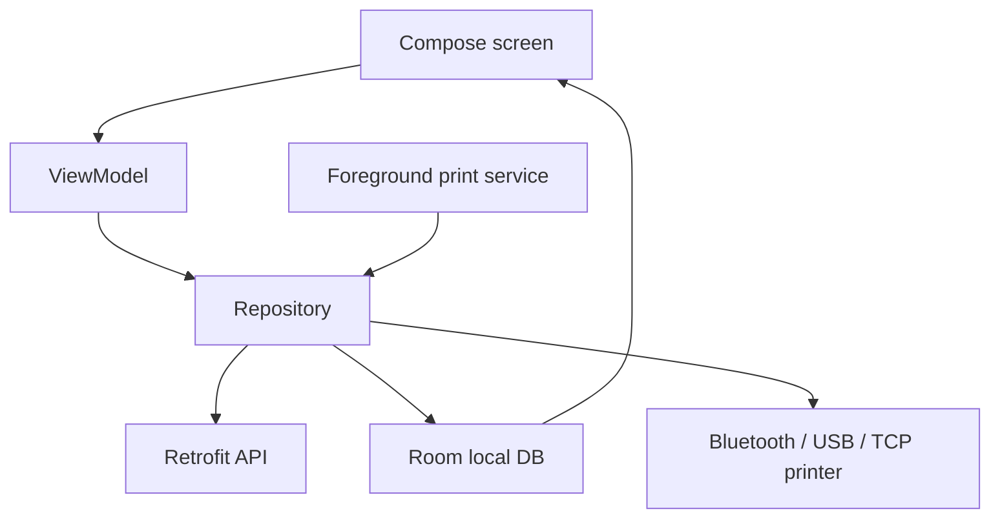
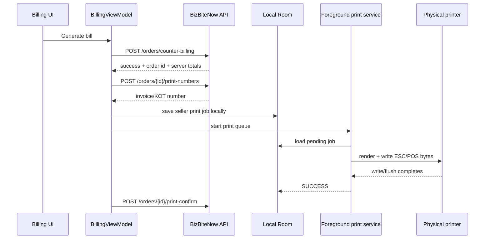

# BizBite Printer Android App — Project Documentation

> यह दस्तावेज़ repository में मौजूद Android client code के behavior को बताता है। यह backend या seller webpage का implementation guide नहीं है: इस repository में उन systems का source code नहीं है। API response के उदाहरण केवल वही fields दिखाते हैं जिन्हें Android client भेजता/पढ़ता है; backend की exact validation और सभी possible messages deployment के अनुसार अलग हो सकते हैं।

## विषय सूची

1. [Project और architecture](#1-project-और-architecture)
2. [Build और configuration](#2-build-और-configuration)
3. [Navigation routes और screens](#3-navigation-routes-और-screens)
4. [Authentication और printer pairing](#4-authentication-और-printer-pairing)
5. [API routes और data contracts](#5-api-routes-और-data-contracts)
6. [Counter billing से print तक](#6-counter-billing-से-print-तक)
7. [Printer queue और transport](#7-printer-queue-और-transport)
8. [Credit/Debit Notes](#8-creditdebit-notes)
9. [Local storage और backend sync](#9-local-storage-और-backend-sync)
10. [Process interruption और fallback matrix](#10-process-interruption-और-fallback-matrix)
11. [Error messages का अर्थ](#11-error-messages-का-अर्थ)
12. [सुरक्षा, limitations और source map](#12-सुरक्षा-limitations-और-source-map)

---

## 1. Project और architecture

BizBite Printer एक native Android app है। UI Jetpack Compose में है। मुख्य layers:

| Layer | जिम्मेदारी | प्रमुख code |
|---|---|---|
| UI / navigation | Compose screens, bottom tabs, dialogs | `ui/navigation`, `ui/screens`, `ui/billing` |
| ViewModels | UI state, coroutines, user actions | `ui/MainViewModel.kt`, billing और feature `viewmodels` |
| Repository | API/local data को UI/domain के लिए बदलना | `data/menu`, `data/auth`, `data/PrinterRepositoryImpl.kt` |
| Domain | print job, printer models और retry policy | `domain/model`, `domain/queue`, `domain/repository` |
| Local persistence | Room queue/history/printer records, preferences | `data/local` |
| Remote API | Retrofit contracts और auth clients | `data/remote`, `di/AppModule.kt` |
| Background work | foreground print loop, WorkManager, boot/FCM | `service` |
| Printer transport | ESC/POS rendering, Bluetooth/USB/TCP | `printer` |
| Credit/debit feature | note models, API adapter, cache, validation | `features/creditDebitNotes` |

Dependency injection Hilt से है। Asynchronous work Kotlin coroutines/Flow में चलता है। Room database का नाम `bizbite-printer.db`, schema version 4 है।

### प्रमुख data paths



**सिद्धांत:** seller billing/order/note data BizBiteNow API से आता है। Print jobs और app print history स्थानीय Room में भी रखे जाते हैं, ताकि local queue/network outage में print transport अलग से चल सके।

---

## 2. Build और configuration

### Toolchain

- Android application ID: `com.bizbite.printer`
- `minSdk`: 26; `targetSdk`: 34; `compileSdk`: 34
- Java/Kotlin bytecode target: 17; JDK 17+ चाहिए
- Compose, Navigation Compose, Hilt/KSP, Room, DataStore, Retrofit/OkHttp, WorkManager और Firebase Messaging dependencies हैं। Versions `app/build.gradle.kts` में हैं।

### URLs

App दो अलग backends से बात करती है:

1. **Printer service backend:** `BASE_URL`; default `https://printer-backend-2.onrender.com/`. इसे Gradle property या environment variable `BASE_URL` से बदला जा सकता है। HTTPS अनिवार्य है।
2. **BizBiteNow seller API:** `BBN_BASE_URL`; इसे `local.properties`, Gradle property, या environment variable से दिया जाता है। यह HTTPS API root होना चाहिए और `/api/` पर समाप्त होना चाहिए, जैसे `https://api.bizbitenow.in/api/`। असली configured URL local configuration पर निर्भर है; credentials/URLs को public logs में न डालें।

`BBN_BASE_URL` न होने या गलत format में होने पर Gradle configuration `BBN_BASE_URL is required` या `BBN_BASE_URL must be an HTTPS API root ending in /api/` error से रुकती है।

### Firebase और signing

- `app/google-services.json` मिलने पर Google Services plugin apply होता है। यह file न होने पर push notification उपलब्ध नहीं होती; foreground polling और WorkManager fallback फिर भी बने रहते हैं।
- Debug APK: `gradlew.bat :app:assembleDebug`। Release signing के लिए अलग keystore तथा `keystore.properties` या `KEYSTORE_FILE`, `KEYSTORE_PASSWORD`, `KEY_ALIAS`, `KEY_PASSWORD` चाहिए। Keystore repository में commit नहीं करना है।
- Release build R8 और resource shrinking चालू करता है।

---

## 3. Navigation routes और screens

Routes `ui/navigation/AppNavHost.kt` में register हैं। ये app के **Compose navigation routes** हैं, HTTP routes नहीं।

| Compose route | Screen | किस काम के लिए |
|---|---|---|
| `login` | `LoginScreen` | Seller/Staff phone और PIN login |
| `dashboard` | `DashboardScreen` | printer/account status, recent local activity, quick actions |
| `printers` | `PrinterSetupScreen` | physical printer add/configure/default selection |
| `billing` | `BillingHubScreen` | Counter Billing, Order History, Credit/Debit Notes tabs |
| `printer-history` | `HistoryScreen` | इस device की Room-based print-job history |
| `settings` | `SettingsScreen` | printer account, copies/cut/drawer, updates, logout/unpair |
| `pair` | `PairingScreen` | automatic app-to-printer-service pairing status/retry |
| `history` | `SellerOrderHistoryScreen` | seller API के billed orders (Billing tab से भी उपलब्ध) |

Login के बाद bottom bar में Home, Printers, Billing, History और Settings हैं। Bottom bar का **History** `printer-history` है। Billing के भीतर **Order History** seller orders वाला tab है—दोनों एक ही history नहीं हैं। Bottom tabs Navigation Compose में state restore करते हैं।

`BillingHubScreen` में billing tabs के नीचे content को उपलब्ध शेष height के अंदर रखा गया है। Credit/Debit Notes के filters और notes एक `LazyColumn` में हैं; status chips कम चौड़ी screen पर horizontal scroll होते हैं।

### Session redirection

- Login successful हो और app route `login` पर हो तो route `dashboard` पर जाता है।
- Session logout/invalid होने पर protected routes हटाकर `login` दिखाया जाता है।
- Welcome screen पहले login से पहले दिखाई जाती है; “Get started”/“Sign in” flag preferences में रखा जाता है।

---

## 4. Authentication और printer pairing

### Seller login flow

1. Phone input से non-digits हटते हैं और अंतिम 10 digits रखे जाते हैं। PIN में केवल digits स्वीकार हैं।
2. Client validation: phone 10 digits का न हो तो `Enter a valid 10-digit phone number.`; PIN blank हो तो `Enter your PIN.`
3. `POST {BBN_BASE_URL}/users/login/app` को `{identifier, pin, fcm_token?}` भेजा जाता है।
4. Envelope में `success` false हो तो API `message` दिखाया जाता है। Login response का `user.role` केवल `Seller` या `Staff` हो सकता है। अन्य role: `This app supports Seller and Staff accounts only.`
5. Agreement false हो तो seller portal में agreement पूरा करने का संदेश दिखता है; session नहीं बनता।
6. Success पर seller token/identity save होते हैं और automatic printer pairing शुरू होती है।

Login errors:

| Failure | App message / action |
|---|---|
| Invalid phone/PIN, HTTP 401 | `Invalid phone number or PIN.` |
| HTTP 429 | Backend message; message blank हो तो 15 मिनट बाद कोशिश करने को कहता है |
| Network/IO/अन्य error | `Could not reach BizBiteNow. Check your connection and try again.` या backend का message |

### Printer service pairing flow

Seller login के बाद pairing manager code माँगता है:

1. `POST {BASE_URL}/api/v1/auth/pair` — request: code, Android/device/app version।
2. Server से access/refresh token, device ID, seller ID और token expiry अपेक्षित हैं। Token encrypted preferences में रखा जाता है।
3. Local printer configs backend पर `PUT /api/v1/devices/me/printers` से sync होती हैं।
4. Pairing code format 8 alphanumeric chars होना चाहिए। Pairing attempts अधिकतम 3; waits 1s और 2s हैं। Timeout 30s है। HTTP 422 पर invalid code एक बार फिर माँगा जा सकता है।
5. Retryable server/network errors pairing screen पर retry button दिखाते हैं। Seller 401 पर seller session expired संदेश आता है; फिर sign-in चाहिए।

App access token expire होने पर printer service API का `TokenAuthenticator` एक बार `POST /api/v1/auth/refresh` की कोशिश करता है। दूसरी 401, missing refresh token, या refresh 401/403 पर local device tokens clear हो जाते हैं। Seller BBN API के authenticated 401 पर seller session logout किया जाता है।

---

## 5. API routes और data contracts

सभी paths नीचे अपने संबंधित base URL के relative हैं। Query/body fields client code से लिए गए हैं। Backend के undocumented success/error JSON की गारंटी इस app source से नहीं दी जा सकती। JSON parsing unknown keys ignore करती है; missing envelope `success` का default false है।

### 5.1 BizBiteNow API (`BBN_BASE_URL`, `/api/` root)

| Method/path | App use | Request / response notes |
|---|---|---|
| `POST /users/login/app` | Seller/staff sign in | `{identifier, pin, fcm_token?}`; `success, token, isAgreed, user, profile` |
| `POST /users/login/init` | API interface में उपलब्ध | `{identifier}`; OTP/login initialization response |
| `POST /users/verify-otp` | API interface में उपलब्ध | `{reqId, otp, purpose}`; verification token |
| `POST /users/login` | API interface में उपलब्ध | `{identifier, pin?, verificationToken?}` |
| `POST /seller/printer/pairing-code` | print service pairing code | `success, code, expiresAt` |
| `GET /seller/me` | seller profile endpoint | JSON object |
| `GET /menu-categories/get` | billing menu categories | `categories[]`; inactive categories हटती हैं |
| `GET /products/dashboard/all` | billing products | `products[]`; `is_available=false` या `is_deleted=true` entries हटती हैं |
| `GET /tables/seller/list` | active dine-in tables | `tables[]`; inactive entries हटती हैं |
| `POST /orders/counter-billing` | bill create | `customer_name`, phone, item lines, payment/order type, table/discount/coupon fields; response में `order` और `_id` जरूरी |
| `GET /orders/list?page={page}&limit={limit}` | seller Order History | page 1 से, page size 20; `success, orders[], count, pagination` |
| `GET /orders/{id}` | order detail | response में `data` या `order` expected |
| `POST /orders/{id}/print-numbers` | invoice/KOT number reserve | `{mode:"invoice"|"kot"}`; `numbers.invoiceNumber/invoiceSeq` या `kotNumber` |
| `POST /orders/{id}/print-confirm` | successful local transport write के बाद confirm | `{mode:"invoice"|"kot"}`; response `success/message/numbers` |
| `GET /credit-debit-notes` | notes list | JSON object; adapter `notes[]`, optional `pagination` पढ़ता है |
| `GET /credit-debit-notes/{id}` | note detail | adapter `note` object या root object पढ़ता है |
| `POST /credit-debit-notes/{credit\|debit}` | create credit/debit note | नीचे create body देखें |
| `PATCH /credit-debit-notes/{id}/cancel` | repository-level cancel method | इस client call में body नहीं भेजी जाती; UI में cancel button अभी disabled है |

`orders/counter-billing` request line में `product_id`/`combo_id`, `quantity`, optional `variant:{name}`, `addons:[{addon_id,name}]`, `instruction` हो सकता है। Payment values UI से `CASH` या `UPI_MANUAL`; order type `dine-in` या `takeaway` है। Server totals final माने जाते हैं; client server-returned subtotal/discount/tax/total को status में दिखाता है।

Note create body:

```json
{
  "order_id": "<seller order id>",
  "reason": "Sales Return",
  "remarks": "optional text for Other reason",
  "items": [
    { "item_id": "<invoice item id>", "quantity": 1, "rate": 12.5, "tax_percent": 5 }
  ]
}
```

**महत्वपूर्ण:** create client local UUID बनाता है, लेकिन current server contract में `client_request_id` नहीं है; UUID request body में नहीं जाता। इसलिए ambiguous timeout पर client blind retry नहीं करता। Note cancel repository में `reason` argument validate होती है, पर actual `PATCH` body में reason नहीं भेजी जाती।

### 5.2 Printer service API (`BASE_URL`)

| Method/path | काम | Request/response |
|---|---|---|
| `GET /actuator/health` | server health | `{status:"UP"}` expected |
| `POST /api/v1/auth/pair` | device pairing | code/deviceName/androidVersion/appVersion; token response |
| `POST /api/v1/auth/refresh` | access token refresh | `{refreshToken}`; new token response |
| `DELETE /api/v1/devices/me` | unpair device | device bearer token |
| `PUT /api/v1/devices/me/fcm-token` | FCM token upload | `{fcm_token}` |
| `POST /api/v1/devices/me/heartbeat` | device heartbeat | empty response accepted when HTTP success |
| `PUT /api/v1/devices/me/printers` | printer configuration sync | id/name/type/address/port/paper width/default |
| `GET /api/print-jobs/pending?printerId=...` | server-side queue fetch | array of `{id,payload}` |
| `PATCH /api/print-jobs/{id}/status` | generic print job status | `{status:"PRINTING\|SUCCESS\|FAILED", errorMessage?}` |
| `GET /api/print-jobs/history?page=0&size=20` | API interface exists | Current Android History screen इसे call नहीं करती; local Room history दिखाती है |
| `GET /api/print-jobs/test-payload?printerId=...` | test receipt payload | JSON payload/blocks |
| `PATCH /api/v1/devices/me/printers/{printerId}/status` | connected/disconnected status | `{status:"CONNECTED\|DISCONNECTED"}` |
| `GET /api/v1/app/latest-release` | update info | `version_code`, `version_name`, HTTPS URL, SHA-256, `mandatory` |

`PrintServiceApi` मौजूद routes को बताता है; इससे backend implementation/availability की पुष्टि नहीं होती।

### 5.3 Shared network behavior

- Printer service API के connect timeout 20s, read timeout 90s, call timeout 100s हैं। BBN client 20s/60s/70s है।
- HTTP failure BBN client में `BbnHttpException(statusCode, message)` बनती है; JSON `message` खाली हो तो `BBN request failed (HTTP n).`।
- Debug HTTP logging BASIC है और Authorization redact है; release में HTTP logging बंद है।
- Cleartext traffic manifest में बंद है।

---

## 6. Counter billing से print तक

### सामान्य success flow



Order server पर create होता है **print से पहले**। Print fail होने पर bill delete/rollback नहीं होता। App pending print save करके अलग retry देता है। Local job ID `bbn-print:{orderId}:{invoice|kot}` है; same document duplicate queue होने से रोकने के लिए stable ID उपयोग होती है। `both` mode में invoice और KOT दो jobs बनते हैं।

### Create bill और print fallback

1. Cart खाली हो, processing जारी हो, dine-in table न चुनी हो, या discount सीमा से बाहर हो तो submission रोकी जाती है। Percentage discount 100% से ऊपर और flat discount subtotal से ऊपर reject होता है।
2. Network validated न हो तो `Connect to the internet before generating a bill. The cart has been kept.`; cart नहीं मिटता।
3. POST शुरू होने से पहले request encrypted `BillingAttemptStore` में बचती है। Server outcome unknown (network/IO/5xx) हो तो duplicate bill रोकने के लिए `billOutcomeUnknown=true`; user को Seller order history check करके “Allow new bill…” flow resolve करना होता है। App खुद order खोजकर reconcile नहीं करती।
4. Non-5xx HTTP 4xx पर request marker clear होता है और backend message/error दिखता है; सामान्यतः user corrected request भेज सकता है।
5. Success response में order ID न मिले तो app reconciliation warning/error देती है; नया bill दुबारा न भेजें जब तक history check न हो।
6. Bill create के बाद pending print encrypted preferences में save होती है। Printer pairing, printer number reservation, default physical printer न होना, या service startup fail होने पर order कायम रहता है और Retry print उपलब्ध होना चाहिए।
7. Retry print पहले number reserve करता है; existing PENDING/PRINTING job को duplicate नहीं करता; FAILED/CANCELLED job को फिर queue करता है (POSSIBLE_PARTIAL case अलग से रोकता है)।
8. Network offline होने पर bill creation और server number reservation काम नहीं करेंगे। Already enqueued local print job physical connection उपलब्ध होने पर चल सकती है।

**Crash gap:** server bill-success response के बाद code request marker clear करता है और फिर pending-print record save करता है। इन दो writes के बीच app/process crash का छोटा window है जिसमें bill server पर बन सकता है लेकिन local retry record न बचे। ऐसी स्थिति में Seller Order History से reconcile करें; same bill blind retry न करें।

---

## 7. Printer queue और transport

### Printer setup screen

`PrinterSetupScreen` में connection type, name/address, port, paper width और default selection configure होते हैं। Default port LAN के लिए 9100, paper width 58mm है। Bluetooth discovery Classic और BLE candidates दिखा सकती है; Android version के अनुसार Nearby devices या older Android fine-location permission माँगी जाती है। Permission reject होने पर scan रोका जाता है; हमेशा के लिए reject होने पर Settings में permission खोलने का मार्ग दिख सकता है। USB type चुनने पर attached USB devices पढ़े जाते हैं; actual output के समय Android USB permission और bulk output endpoint चाहिए।

Save action repository में physical printer config persist करता है, default selection update करता है और backend पर printer registration sync की कोशिश करता है। Local printer record मौजूद रह सकता है अगर backend sync fail हो; unsynced config बाद के service sync में भेजी जाती है। Invalid address/port/config या no default printer पर UI message `MainViewModel.action` से आता है। Virtual printer save नहीं किया जा सकता।

### Queue lifecycle

1. `enqueueSellerPrint`/job enqueue physical default printer check करता है। Job Room में `PENDING` रहता है।
2. Foreground service notification (`Print service is running`) के साथ polling loop चलाता है। Loop paired device के लिए server jobs fetch, interrupted local jobs recovery, फिर local pending job process, outbox/printer sync और heartbeat करता है। Poll interval 15 seconds है।
3. Local job FIFO order में एक-एक process होती है। `PRINTING` Room में persist होने के बाद payload render होता है और selected printer पर bytes write होते हैं।
4. Write/flush बिना exception पूरा हुआ तो local job `SUCCESS`। यह transport write का evidence है, paper sensor acknowledgement नहीं।
5. Generic server-originated jobs के PRINTING/SUCCESS/FAILED callbacks outbox में जाते हैं। `bbn-print:` seller jobs और test jobs इस generic status callback से intentionally excluded हैं; seller jobs BBN `print-confirm` endpoint से confirm होते हैं।

### Supported printer connections

| Type | Connection behavior | Typical break/fallback |
|---|---|---|
| Bluetooth Classic SPP | RFCOMM SPP; secure failure पर channel 1 fallback; live socket reuse; discovery cancel before connect | permission/device/socket error retry; ACL disconnect status update |
| Bluetooth LE | GATT writable characteristic, bounded write chunks | Manufacturer-specific GATT profile अलग; connect/write failure पर job retry/fail |
| USB | Android USB host, bulk output endpoint | Android USB permission prompt; denied permission `PERMISSION_DENIED` terminal failure |
| TCP/LAN | raw socket; default port 9100 | Phone-to-printer LAN path टूटे तो connection retry; Internet access printer LAN connection का substitute नहीं |

Virtual/mock printer supported नहीं है। Printer config में 58mm या 80mm width; copies 1–10; auto cut और cash drawer user settings से control होते हैं।

### Receipt rendering

`ReceiptRenderer` payload object में `blocks` array लेता है। Supported block types: `TEXT`, `TWO_COLUMN`, `ITEM_ROW`, `DIVIDER`, `IMAGE` (base64), `QR`, `BARCODE` (EAN13/Code128) और `FEED`; unknown type skip होता है। Non-ASCII text raster image में convert होता है। Invalid image data log होकर skip होती है। Payload object/blocks invalid हो तो render job fail हो सकती है।

Seller invoice/KOT JSON `SellerReceiptMapper` बनाता है; `orders` DTO में product/customer/totals के missing values fallbacks से render होते हैं (उदाहरण: customer “Walk-in Customer”, blank item name “Product”, missing amount default 0/placeholder)।

### Test print और device status

Test print पहले printer service backend से `GET /api/print-jobs/test-payload?printerId=...` payload माँगता है, फिर सामान्य local queue से physical printer पर लिखता है। Network/payload/service failure पर message सीधे user को दिखता है; successful queue के बाद screen job Flow में SUCCESS/FAILED आने तक देखती है। Printer status check transport connection/status bytes पर आधारित है; unsupported/no replies मिलने पर connected transport को CONNECTED माना जा सकता है, इसलिए यह paper निकलने की पूर्ण पुष्टि नहीं है।

### Queue retry policy

- Generic transient failures के अधिकतम 5 attempts हैं; delay 1s, 2s, 4s, 8s के हिसाब से बढ़ता है। अंतिम सीमा पर `FAILED`।
- Bluetooth path में अलग अधिकतम 3 connection attempts लागू हैं।
- `PAPER_OUT`, `COVER_OPEN`, `PERMISSION_DENIED` non-retryable terminal errors हैं।
- Write के बीच connection टूटे और partial data भेजे जाने की संभावना हो तो `POSSIBLE_PARTIAL`; इसे स्वतः reprint नहीं किया जाता। Paper output जाँचकर ही History से manually reprint करें।
- Successful/recent/cancelled/potentially partial remote job को `fetchPending` duplicate queue नहीं करता।

---

## 8. Credit/Debit Notes

### UI और data

Billing tab में तीन subtabs हैं: Counter Billing, Order History और Credit/Debit Notes। Notes screen search, from/to date, type, status, customer, invoice ID/number और reason के **loaded notes पर client-side filters** लगाती है। Date parse invalid हो तो वह सीमा filter लागू नहीं होती। List UI एक बार में 15 notes दिखाती है; अधिक local loaded notes हों तो “Load more” बढ़ाता है—यह server page request नहीं है।

Note model में id/number/type/status, invoice/customer, reason/description, subtotal/tax/total, items, settlement, timeline और timestamps हैं। Money internally paise में रखी जाती है; adapter API में `*_paise` को प्राथमिकता और rupee-valued fields को fallback मानता है। Unknown status `UNKNOWN` बनता है।

### Current real API paths

| Use | Method/path | Actual request/response handling |
|---|---|---|
| Notes list | `GET /credit-debit-notes` | response `success=true` जरूरी; adapter `notes[]`, pagination पढ़ता है |
| Note detail | `GET /credit-debit-notes/{id}` | `success=true`; `note` child या root object |
| Create CN | `POST /credit-debit-notes/credit` | order ID, reason, optional remarks, item ID/quantity/rate/tax |
| Create DN | `POST /credit-debit-notes/debit` | वही body; type path में |
| Cancel API method | `PATCH /credit-debit-notes/{id}/cancel` | no request body in this app; UI action अभी disabled (“Cancel (Phase 4)”) |
| Order snapshot | `GET /orders/{id}` | `data` या `order`; paid/due/payment ledger fields app DTO में नहीं हैं |

`docs/credit-debit-api-map.md` backend contract audit और gaps का अलग document है। उसके प्रस्तावित endpoints/mocks को live endpoint न समझें।

### Note create validation और duplicate safety

- Reason required; “Other” चुनने पर description required। कम से कम एक item और positive quantity required।
- Invoice number missing हो तो message invoice पहले print करने को कहता है। Item-rate/rate-difference/additional-quantity/tax overrides reason के अनुसार validate होते हैं।
- Credit quantity ceiling पहले से non-cancelled notes घटाकर **client estimate** है; backend final authority है। Debit additional quantity में rate और GST required हैं।
- Form offline/loading/saving/status-unknown या invoice missing हो तो save रोक दी जाती है। Double submit `CreateSubmissionGate` से guard होता है।
- HTTP 409 पर form/current invoice notes reload होते हैं; “invoice notes changed…” error।
- HTTP 4xx पर backend message field/form error में दिखता है।
- Network IO, timeout या HTTP 5xx पर result ambiguous मानकर “Status unknown. Check invoice notes before trying another create.”; नया create lock रहता है। User “Check status” से list refresh करता है। Exactly one matching new note मिले तो outcome दिखता है; zero/multiple match पर create अभी भी lock रहता है। Mock list backend creation confirm नहीं कर सकती।
- Create success के बाद list refresh best effort है; list refresh fail हो जाने पर भी create response outcome screen में रखा जाता है।

### Offline cache और detail supplements

- `CreditDebitNotesCache` process-memory cache है; seller ID scoped और logout पर clear। यह Room/disk cache नहीं है, इसलिए process restart के पार cache guaranteed नहीं।
- List refresh fail हो तो पहले loaded notes या current seller cache रखे जाते हैं; UI “Offline · showing session-cached notes” और error/retry दिखाता है। Cache खाली हो तो no notes + error हो सकते हैं।
- Real detail में settlement/timeline missing हों तो current code mock fixture से supplement करता है; mock label/data को backend fact न मानें। Real detail के साथ payment supplement भी mock fixture से आ सकता है।
- Mock-only capabilities (invoice payments, full cancellation, refunds, credit application, refund status, PDF, customer credit, reauth) के fixtures हैं, पर current UI में इन्हें production backend functionality नहीं मानना है। कुछ action placeholders disabled हैं। Endpoint toggles source config में default fixed हैं; runtime settings screen नहीं है।

### Role policy (client-side visibility)

| Seller role | View | Standard create | Full cancel | Cancel note / refund approval / tax override |
|---|---:|---:|---:|---|
| Staff/Cashier | yes | yes | no | no |
| Manager | yes | yes | no | refund approve/manual verify yes; tax override no |
| Owner/Admin | yes | yes | yes | cancel/refund/tax override yes |
| Platform Support | yes | no | no | no |
| Unknown/restricted | yes | yes (standard note) | no | no |

यह Android UI permission policy है; वास्तविक authorization backend पर लागू होना चाहिए। Client UI अकेला security boundary नहीं है।

---

## 9. Local storage और backend sync

### Room persistence

| Entity/table | क्या रहता है |
|---|---|
| `local_job` | job ID, serialized receipt payload, status/retry/error, timestamps, sync flag |
| `printer_config` | physical printer config/default selection/backend sync flag |
| `status_outbox` | generic job status callbacks जो server तक नहीं पहुँचे |
| `printer_status_outbox` | connected/disconnected callback जो server तक नहीं पहुँचे |

App upgrade पर Room migrations 1→2→3→4 चलती हैं। Database open पर पुराने virtual-printer data हटाए जाते हैं; physical printer/history बचते हैं। App data clear/uninstall से local Room history/queue और preferences हट सकते हैं।

### Sync matrix

| Data | Source of truth / sync behavior |
|---|---|
| Menu/products | `BillingViewModel` initialization पर categories/products/tables API fetch; code में periodic live refresh नहीं। Error पर “Retry load menu”; webpage edit app open रहे तो स्वतः push नहीं होती। |
| Seller orders | Create/list/detail BizBiteNow backend endpoints; list page 20; History screen offline order cache नहीं रखती। |
| Seller invoice/KOT print flag | Local write success के बाद `print-confirm`; offline/error पर confirmation retry loop; backend order record में flag तभी updated जब endpoint सफल हो। |
| Local printer job history | Room Flow. `HistoryScreen` local rows दिखाता है; `GET /api/print-jobs/history` API method मौजूद है मगर current screen उससे load नहीं करती। |
| Generic server job status | Local outbox then `PATCH /api/print-jobs/{id}/status`; network failure में outbox रहती है और later sync होती है। |
| Seller print job status | Generic outbox से skip; BBN order print-confirm route अलग है। |
| Printer config/status | local config retained; unsynced printer/backend status outboxes network पर retry होते हैं। |
| Credit/debit notes | Server API list/detail/create; process-memory cache offline read assist है, real-time sync/automatic write queue नहीं। |
| App update | paired होने पर startup check और हर 6 hours WorkManager check; network/server error retry limited है। |

इसलिए app का local History पूरा webpage पर दिखेगा, इसकी guarantee नहीं है। Seller order का printed flag दिखने के लिए webpage को backend order के `invoice_printed_at`/`kot_printed_at` fields पढ़ने चाहिए; उस webpage का code इस repository में नहीं है।

---

## 10. Process interruption और fallback matrix

यह section बताता है process बीच में रुकने पर क्या होता है; “fallback” हर operation के लिए समान नहीं है।

| रुकने का समय | Persisted state | Restart/retry behavior | User को क्या करना चाहिए |
|---|---|---|---|
| Bill submit से पहले Internet नहीं | cart UI state में; request server को नहीं गई | कोई auto submit नहीं | Internet लौटने पर Generate करें; cart रखा जाता है |
| Bill POST के बीच timeout/process loss | encrypted request marker रहता है | `billOutcomeUnknown` duplicate POST रोकता है; auto server reconciliation नहीं | Seller Order History check करें; confirm न हो तभी नया bill allow करें |
| Server ने bill बनाया, response lost | request marker; server order हो सकता है | same unknown-outcome guard | History में order ढूँढें; blind retry से duplicate order बन सकता है |
| Bill success के बाद pending-print save से पहले crash | बहुत छोटा code window; local print record छूट सकता है | automatic print retry की guarantee नहीं | Seller history से order निकालें और जरूरत पर order details से print शुरू करें |
| Pending print saved, number reserve/network fail | encrypted pending order/mode रहता है | app reopen पर retry state restore; Retry print फिर reservation माँगता है | Network लौटने पर Retry print |
| Number reserve के बाद enqueue से पहले crash | pending print रहता है; remote reserve हुआ हो सकता है | Retry फिर reserve कर सकता है; server reservation idempotency app contract में निर्दिष्ट नहीं | Retry; order/number backend state देखें अगर duplicate reservation concern हो |
| Room में job queued, service start fail | job `PENDING` local DB में रहता है | service restart/boot receiver; WorkManager safety pass भी है | Print service चलाएँ/History में pending देखें; वही job duplicate न बनाएँ |
| Print के दौरान app process/service kill | Room में status `PRINTING` रह सकता है | recovery इसे `FAILED/POSSIBLE_PARTIAL` बनाती है; auto reprint नहीं | Printer से निकला paper check करें, फिर ही manually reprint |
| Printer/transport disconnect before write | retryable error में attempts; बाद में `FAILED` | queue policy error-specific; reconnect पर service अगला poll/process करती है | Printer power, paper, cover, Bluetooth/LAN/USB और permission जाँचें; terminal failure पर retry करें |
| Data write के बाद success, Internet lost | Room `SUCCESS`; seller confirm network पर fail | Billing/order-history VM confirm को लगभग हर 30s retry करती है; process alive रहने तक | Network लौटाएँ; order screen खोलकर confirmation retry observe करें |
| Success के तुरंत बाद app killed, confirm pending | local SUCCESS persisted | confirm worker अलग durable worker नहीं; billing/order history VM job Flow फिर observe कर confirm चला सकती है | App खोलकर Billing या Seller Order History खोलें; backend printed flag verify करें |
| Note create request में connection टूटे | form state; operation outcome unknowable | no blind retry; status unknown lock | Check status से notes reload; create फिर तभी जब स्थिति resolve हो |
| Note create के बाद list refresh fail | create response local UI state में | list stale/offline रह सकती है; create outcome मौजूद | Refresh notes; note create दोबारा न करें जब तक list check न हो |
| App reboot/package update | Room queue/config बची हो | BootReceiver service start best-effort + 15-min periodic Worker | Android auto-start/battery restriction रोकें तो app manually खोलें |
| FCM unavailable / `google-services.json` missing | push event नहीं मिलेगा | foreground 15s polling और 15-min WorkManager fallback | App/service को background restrictions से exempt रखें जहाँ OEM मांगता हो |
| Logout | seller session/identity और note memory cache clear; `SessionManager.logout()` अपने आप printer device को unpair या foreground service को stop नहीं करता | login route पर वापस जाता है; device pairing token/app queue अलग persistence में हो सकते हैं | दूसरे seller/account पर काम करना हो तो पुराने printer account को Settings से explicitly Unpair करके फिर pair करें |
| Explicit unpair | `DELETE /api/v1/devices/me` best effort; response/network fail होने पर भी local device credentials clear | `MainViewModel` foreground service stop करता है; seller login session अलग रहता है | Server failure message आए तो local unpair हो चुका हो सकता है; जरूरत पर फिर Pair करें |

### Interruptions में क्या auto retry नहीं होता?

- Counter bill create request को timeout के बाद blind auto retry नहीं किया जाता; duplicate prevention प्राथमिकता है।
- Credit/debit note create को ambiguous outcome के बाद auto retry नहीं किया जाता; “Check status” आवश्यक है।
- `POSSIBLE_PARTIAL` print को automatic retry/reprint नहीं करते; partial duplicate receipt का जोखिम रोकना इसका उद्देश्य है।
- Seller print confirmation retry ViewModel coroutine में है; इसे independent durable WorkManager job नहीं माना जाना चाहिए। App restart के बाद Billing/Order History खोलना recovery trigger करता है।
- Menu/product refresh, seller-order listing और note detail के लिए offline full data snapshot/cache guaranteed नहीं है (notes list का सीमित memory cache अपवाद है)।

---

## 11. Error messages का अर्थ

| Message / code | आम कारण | Fallback |
|---|---|---|
| `Could not load seller menu. Check your connection and retry.` | menu/categories/products/table request exception | screen का Retry load menu; पहले से UI में मौजूद state बना रहता है |
| `Connect to the internet before generating a bill. The cart has been kept.` | validated network नहीं | cart बचा; offline bill POST नहीं |
| `The bill result is uncertain because the connection ended...` | POST result ambiguous (IO/timeout/5xx) | duplicate guard; Seller Order History reconciliation |
| `Bill created... Printing could not start...` | order बन गया पर pairing/number reserve/queue/service/printer चरण fail | order delete नहीं; saved pending print/Retry उपलब्ध, error type के अनुसार |
| `Print failed: ...` | test job transport write/permission/printer failure | local History में code/message; retry policy देखें |
| `PAPER_OUT`, `COVER_OPEN`, `PERMISSION_DENIED` | terminal printer condition | automatic attempts बंद; condition ठीक करके user retry |
| `POSSIBLE_PARTIAL` | app/write mid-stream interrupt; bytes कुछ printer तक पहुँचे हो सकते हैं | no automatic resend; paper physically inspect करें |
| `Could not load notes...` / HTTP message | note-list API/network/server failure | session cache दिख सकती है; Retry refresh |
| `Status unknown. Check invoice notes before trying another create.` | note POST की outcome confirm नहीं | create locked; Check status; कोई blind retry नहीं |
| `Invoice notes changed while this form was open...` | API HTTP 409 | form/notes reload और user review |
| `This document already has a print in progress...` | same order/mode local job pending/printing | existing job देखें; duplicate generate नहीं |
| `The previous write may be partial...` | previous seller print `POSSIBLE_PARTIAL` | Printer job history में paper output inspect करें |
| `Seller session expired. Sign in again.` | seller API 401/session invalid | login; pairing/token refresh policy लागू |
| `Printer setup server is starting or temporarily unavailable. Try again.` | pairing API 502/503/504 | bounded automatic retry, फिर Pair screen retry |

### App update

Latest release check paired device पर startup में और WorkManager से हर 6 घंटे schedule होती है। Check failure पर dashboard message `Could not check for app updates.` या background worker retry देता है; इससे installed app बंद नहीं होती। Download के समय URL HTTPS और SHA-256 का 64 hex होना आवश्यक है; package अधिकतम 250 MiB है। HTTP failure `Update download failed with HTTP n.` और oversize/download failure पर partial APK हटती है। Bad digest पर downloaded APK delete होती है और `The downloaded update failed its integrity check.` आता है। APK install permission missing हो तो Android “Install unknown apps” settings खुलती हैं और verified APK cache में रहती है; permission देने के बाद update action फिर शुरू करें। App Android installer खोलती है; installation user/system approval के अधीन है।

UI में जहां `BbnHttpException` मिले वहां backend message प्राथमिकता है; सामान्य IOException में screen-specific generic network message दिख सकता है। Logs में details हो सकती हैं; user-facing message हर exception का exact cause नहीं बताता।

---

## 12. सुरक्षा, limitations और source map

### Security/storage

- Printer service access/refresh tokens और BillingAttemptStore encrypted preferences में हैं। Seller session/identity अलग stores में हैं।
- Receipt payload और print records Room database में persist हैं; इन्हें sensitive operational data मानें।
- Manifest cleartext network बंद करता है। HTTP logs में auth header redact होता है। Release logging off है।
- Logout पर seller identity/session और credit-note in-memory cache clear होते हैं। Unpair endpoint failure पर भी local device credentials clear किए जाते हैं और operation error surface हो सकता है।

### Scope limits जिन्हें code पढ़ते समय ध्यान रखें

1. API interface में method होना यह प्रमाण नहीं कि backend deployment में route मौजूद है।
2. `GET /api/print-jobs/history` method मौजूद है, पर app UI local Room history उपयोग करती है।
3. Credit/debit docs में “proposed”, “mock”, “missing” बताई चीज़ें live feature नहीं हैं। `docs/credit-debit-api-map.md` अलग audit है।
4. Note cancellation repository method है, पर screen button disabled है और body reason नहीं भेजी जाती।
5. `eligibilityEstimate` client-side estimate है; backend validation अंतिम है।
6. Successful transport write physical paper emergence को verify नहीं करता।
7. Product changes के लिए realtime subscription/polling code नहीं मिला; initial menu load/retry से server snapshot आता है।
8. Seller print confirmation asynchronous coroutine में retry होती है; durable outbox/WorkManager confirmation specifically नहीं है।
9. Backend/webpage source इस repository में नहीं है, इसलिए web UI में field render/route response का दावा यहाँ से verify नहीं किया जा सकता।

### Source map

| विषय | प्रमुख files |
|---|---|
| App startup/navigation | `BizBitePrinterApp.kt`, `ui/MainActivity.kt`, `ui/navigation/AppNavHost.kt`, `BottomBar.kt` |
| Login/session | `ui/login/LoginViewModel.kt`, `data/auth/AuthRepository.kt`, `data/session/SessionManager.kt`, `data/security` |
| Pairing | `data/auth/AutoPairManager.kt`, `ui/screens/PairingScreen.kt`, `data/PrinterRepositoryImpl.kt` |
| Counter billing | `ui/billing/BillingScreen.kt`, `BillingViewModel.kt`, `data/menu/MenuRepository.kt`, `data/remote/BbnApi.kt` |
| Seller order history | `ui/screens/SellerOrderHistoryScreen.kt` |
| Note workflows | `ui/billing/BillingHubScreen.kt`, `CreateCreditDebitNoteScreen.kt`, `features/creditDebitNotes/**` |
| Print queue/background | `service/PrintForegroundService.kt`, `QueueSafetyWorker.kt`, `BootReceiver.kt`, `PrinterMessagingService.kt` |
| Print persistence/status sync | `data/PrinterRepositoryImpl.kt`, `data/local/PrinterDao.kt`, `Entities.kt`, `PrinterDatabase.kt` |
| Physical printer | `printer/PrinterConnections.kt`, `BluetoothSppConnection.kt`, `BluetoothLeConnection.kt`, `UsbConnection.kt`, `TcpConnection.kt`, `ReceiptRenderer.kt`, `EscPosBuilder.kt` |
| API/config | `data/remote/BbnApi.kt`, `PrintServiceApi.kt`, `ApiModels.kt`, `di/AppModule.kt`, `app/build.gradle.kts` |
| Updates/settings | `ui/MainViewModel.kt`, `ui/screens/SettingsScreen.kt`, `service/LatestReleaseWorker.kt`, `update/UpdateInstaller.kt` |
| Existing note API audit | `docs/credit-debit-api-map.md` |

### Build commands

```powershell
.\gradlew.bat :app:assembleDebug
.\gradlew.bat :app:testDebugUnitTest
```

Tests are present under `app/src/test`; physical printer behavior, Android permission prompts, background execution and deployed backend contracts require device/backend validation.

